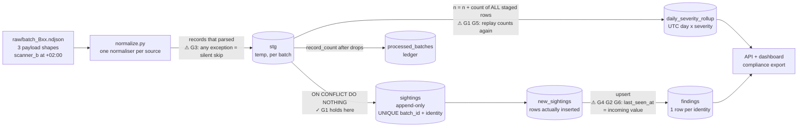

# System: one batch, end to end

One `load_batch` call is one transaction: a crash mid-batch leaves nothing behind.

| | Where it can break | Measured in this bundle |
|---|---|---|
| **G1** Idempotent | Rollup adds `count(*) FROM stg`, not the rows that were actually inserted ([load.py:44-49](pipeline/load.py#L44-L49)) | **Broken.** Each replay of B03 adds 2,156 to the rollup. Sightings and findings are unchanged. |
| **G2** Order-independent | Findings upsert overwrites `last_seen_at`, `severity` and `cvss` with the incoming batch's values ([load.py:37-40](pipeline/load.py#L37-L40)) | **Broken** on `last_seen_at` (3,142 findings differ in reverse order). Severity and cvss: 0 differences in this data. |
| **G3** Complete | `except Exception: continue` in the normaliser ([normalize.py:41](pipeline/normalize.py#L41) raises, [normalize.py:64](pipeline/normalize.py#L64) swallows). Also latent: a repeated identity inside one batch would hit `DO NOTHING` (0 cases in this data). | **Broken.** 951 CIS records dropped (all of scanner_c's CIS records). |
| **G4** Monotonic | `last_seen_at = EXCLUDED.last_seen_at`, while `first_seen_at` is protected with `LEAST` ([load.py:39-40](pipeline/load.py#L39-L40)) | **Broken.** A late B01 moves 1,970 findings back by up to 2 days 18 h. |
| **G5** Rollup = detail | Same increment as G1. Also the day bucket: the DB session runs in `Asia/Jerusalem`, so only `AT TIME ZONE 'UTC'` gives the right day. | **Holds** after a clean load. **Broken** after any replay. Bucketing is UTC-correct. |
| **G6** Late arrival | Same upsert as G4 | **Broken.** The end state differs from the in-order load. The rollup stays right. |

Reproduction for every number: [EVIDENCE.md](EVIDENCE.md). To check any version end to end, use the [contract-verifier](.claude/agents/contract-verifier.md) agent.
